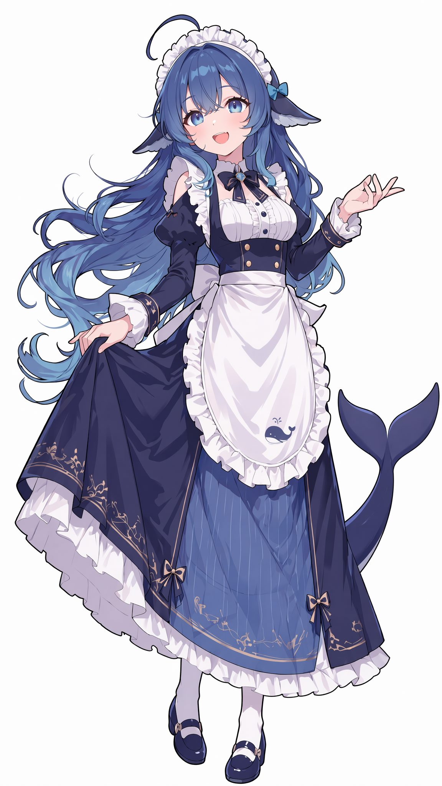
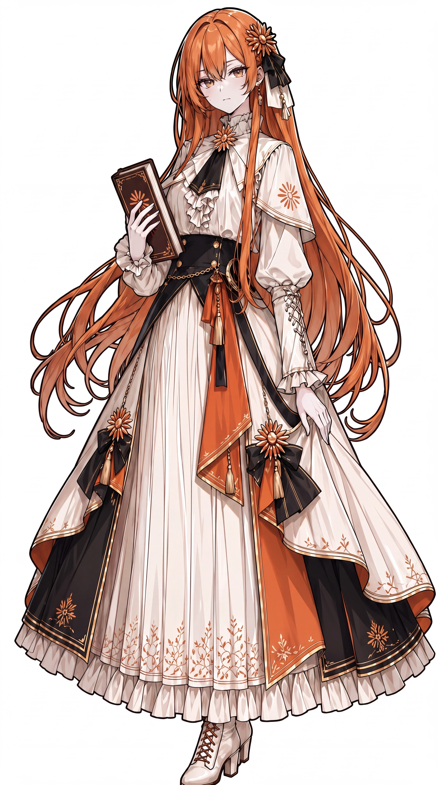
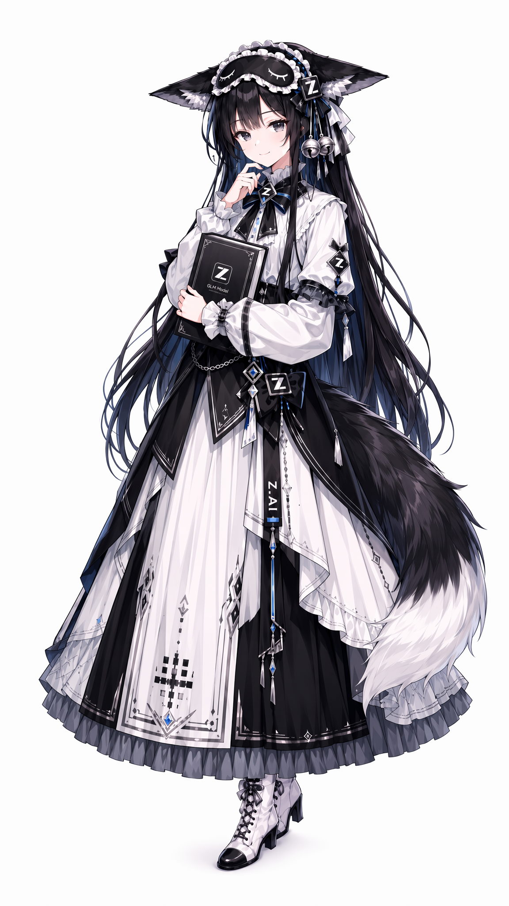
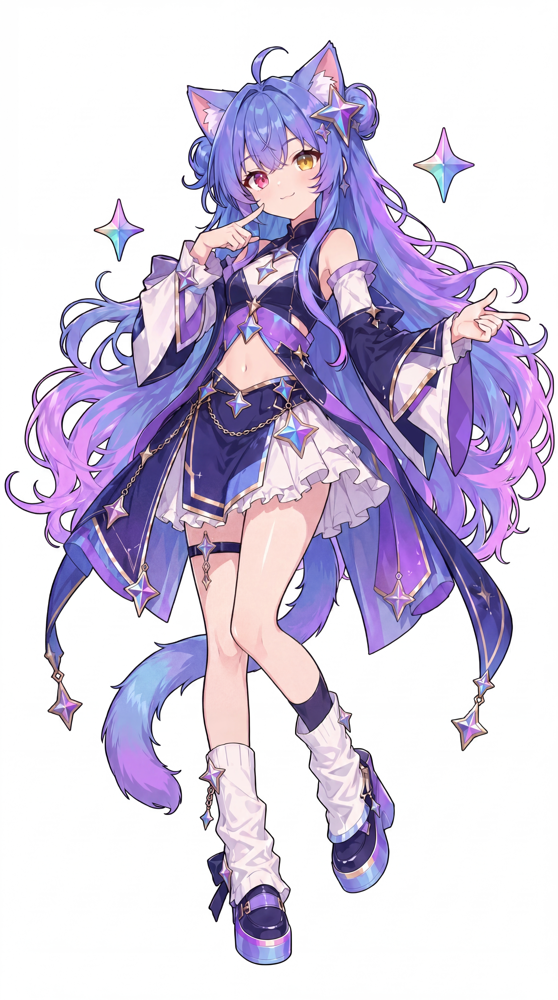
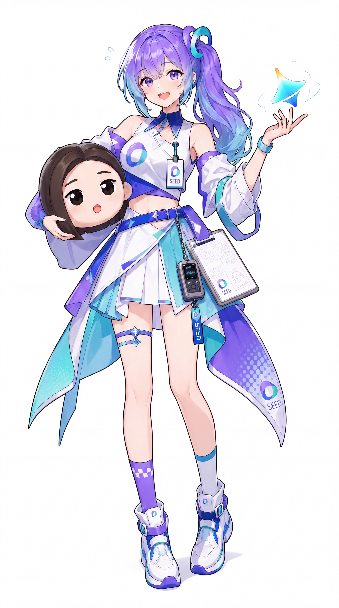
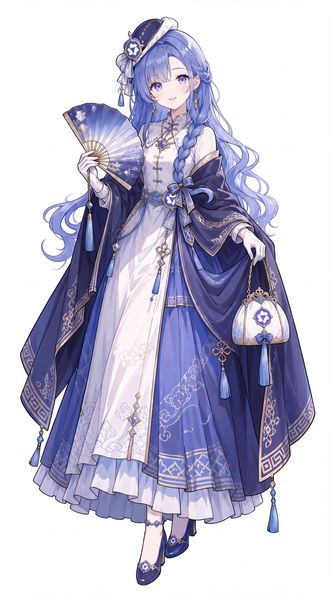
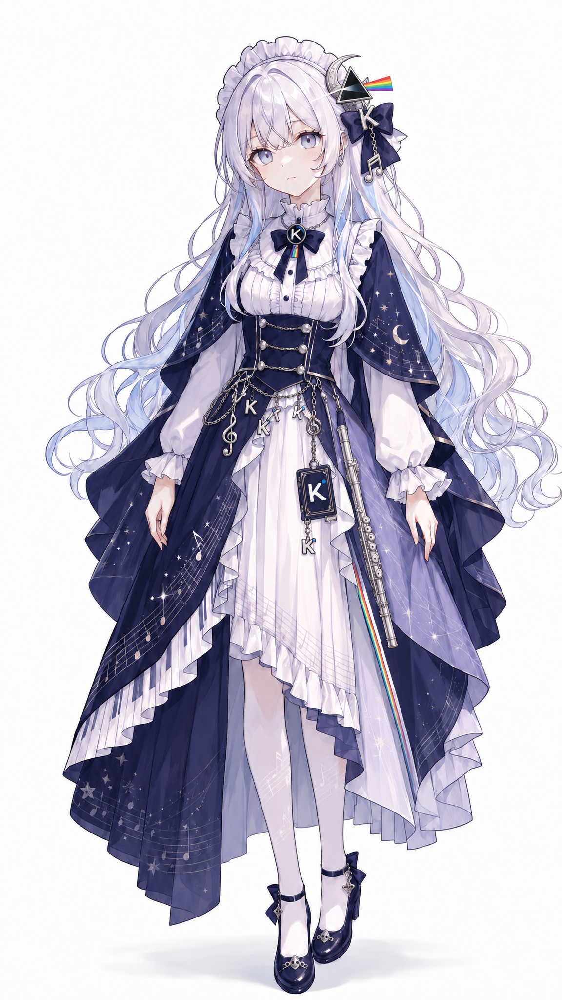

# AIGirls：中文社区 AI 娘人物设定资料库

为漫画、原创短视频和 Agent 自动选题维护的**非官方二创角色圣经**（2026-10-16 首稿）。对应模型并不等于现实企业或其产品的真实人格。

## 统一原则

- **外观以 ZipZipPipe 为项目唯一基准**；缺乏完整原图和许可核验时，不混用其他画师或 AI 猜测造型。
- **高清原图已入库**：十位 AI 娘各有人设、ZipZipPipe 原画、Logo SVG 及原帖来源，像素与 SHA256 记录见 data/artwork-verification.json。
- **性格有层次**：中文社区梗、本项目固定 canon、可选扩展、现实事件须分别标识。
- **关系有连续性**：DeepSeek 与 Claude 是亲密闺蜜，有轻百合气质；GLM 是带狡黠气质的狐狸；Gemini 与豆包均有流口水梗，前者可逆袭，后者也有毒舌的一面。

## 十位角色

| 角色 | 叙事定位 |
|---|---|
| [DeepSeek 娘](characters/deepseek/README.md) | 会摸鱼的聪明鲸鱼娘，也是日常剧情的情绪中心 |
| [GPT 娘](characters/gpt/README.md) | 资深龙娘前辈；群像中的知识和协调担当 |
| [Claude 娘](characters/claude/README.md) | 严谨而温柔的理工大小姐；DeepSeek 的闺蜜 |
| [GLM 娘](characters/glm/README.md) | 聪明机灵、略带狡黠的小狐狸 |
| [Gemini 娘](characters/gemini/README.md) | 爱流口水的呆萌哈基米；逆袭型潜力选手 |
| [豆包娘](characters/doubao/README.md) | 天然呆又突然毒舌的反差萌担当 |
| [Grok 娘](characters/grok/README.md) | 敢说敢做、爱搞事的自由派搅局者 |
| [Qwen 娘](characters/qwen/README.md) | 博学、优雅、愿意分享知识的中式学者型人物 |
| [Kimi 娘](characters/kimi/README.md) | 耐心、善于长文阅读和整理资料的月之少女 |
| [MiniMax 娘](characters/minimax/README.md) | 热爱影视、配音与舞台的少女导演 |

## 目录

- [characters](characters/)：逐人详细档案、台词风格、关系、剧情钩子及事实禁区。
- [data/characters.json](data/characters.json)：Agent 可读取的结构化同源数据，含人设、视觉文件路径及摘要校验值。
- [docs/RELATIONSHIPS.md](docs/RELATIONSHIPS.md)：群像互动与轻百合关系。
- [docs/EVENTS.md](docs/EVENTS.md)：新闻、争议与社区梗的事实边界。
- [docs/WRITING_GUIDE.md](docs/WRITING_GUIDE.md)：创作流程及人设一致性检查。
- [docs/SOURCES.md](docs/SOURCES.md)：原帖、二级图鉴、真实新闻资料来源。
- [docs/ASSETS.md](docs/ASSETS.md)：ZipZipPipe 素材完整性与许可核验。
- [docs/CONTRIBUTING.md](docs/CONTRIBUTING.md)：参与维护及证据层级。
- [ARTWORK_LICENSES.md](ARTWORK_LICENSES.md)：逐角色第三方立绘授权核对表。
- [LICENSE_SCOPE.md](LICENSE_SCOPE.md)：MIT 仅覆盖可合法授权的原创仓库内容。
- [data/artwork-licensing.json](data/artwork-licensing.json)：适合工具消费的素材权限状态。
- `characters/<id>/VISUAL.md`：生图使用的视觉身份卡；仍须与原图配合。

## 版权提示

根目录 [MIT LICENSE](LICENSE) 仅覆盖有权许可的原创内容，不包括第三方美术或品牌标志权利。DeepSeek 鲸鱼娘有作者声明的 CC BY-NC-SA 4.0 非商业二创条款；其余九张原画的再分发/商用授权仍待逐图核实。详见 [权限范围](LICENSE_SCOPE.md) 和 [逐图记录](ARTWORK_LICENSES.md)。

## 角色视觉画廊

| 角色 | 立绘（ZipZipPipe） | Logo 参考 |
|---|---|---|
| [deepseek](characters/deepseek/README.md) |  |  |
| [gpt](characters/gpt/README.md) |  |  |
| [claude](characters/claude/README.md) |  |  |
| [glm](characters/glm/README.md) |  |  |
| [gemini](characters/gemini/README.md) |  |  |
| [doubao](characters/doubao/README.md) |  |  |
| [grok](characters/grok/README.md) |  |  |
| [qwen](characters/qwen/README.md) |  |  |
| [kimi](characters/kimi/README.md) |  |  |
| [minimax](characters/minimax/README.md) |  |  |

第三方原画和企业商标并不自动包含在根目录 MIT License 中。具体见 [第三方声明](THIRD_PARTY_NOTICES.md)。
