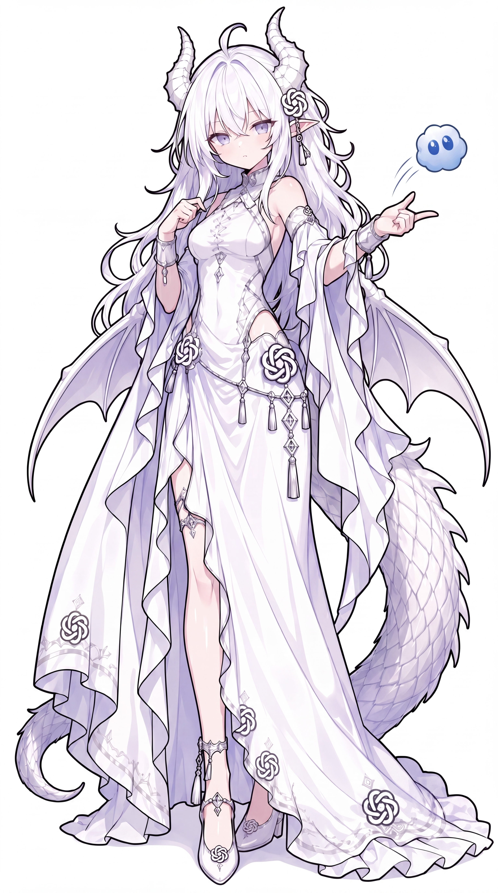

# GPT 娘

> **角色功能**：资深龙娘前辈；群像中的知识和协调担当
>
> 视觉统一参考 ZipZipPipe，原始立绘、Logo SVG 与对应来源文件已存储在本角色目录。

## 中文社区的已有梗和线索

- 白发龙娘、小龙娘是 ZipZipPipe 相关二创体系中辨识度较高的路线。
- 资历深、经验丰富、偶尔有前辈式的矜持。

## 本项目的固定设定（canon）

- 她很强也很可靠，但不必永远正确。
- 能够在新模型不断出现时重新学习、调整自己。

## 可能的扩展演绎（尚非全网共识）

- 善于组织大家，却可能不擅长处理微妙的少女心事。
- 威严外壳下偶尔露出小龙娘的可爱。

## 语言、表情与行动

表达完整、自信、有前辈气质；偶尔一本正经地开玩笑。

## 关系与互动

- DeepSeek：跨世代的互相照顾。
- Grok：大胆后辈与端庄前辈。
- Claude：专业上的相互尊重。

## 可直接用于选题的剧情钩子

- 准备庄严发布会却被办成茶会。
- 新版本出现后意外发现自己也需要上课。
- 协调争吵的模型同事时反而被他们拉下水。

## 禁止混淆的边界

- 不要默认所有 GPT 同人都是龙娘：本项目仅统一采用 ZipZipPipe 路线。
- 不强制其他角色衬托她的实力。

## 原始资料索引

- 角色索引（第三方整理，须进一步追溯作者原帖）：https://genderswapai.com/zh-CN/ai-gijinka/gpt
- ZipZipPipe 最初九人群像：https://www.bilibili.com/video/BV1tE9XBbErS/
- [资料分级与更新规则](../../docs/CONTRIBUTING.md)

## 立绘和品牌标志参考

- [ZipZipPipe 高清原图](portrait.jpg)：3072 × 5504；SHA256 详见 [核验记录](../../data/artwork-verification.json)。
- [品牌 Logo SVG（社区维护的标准品牌标志参考）](logo.svg)。
- [第三方作者及许可提醒](SOURCE.md)。

