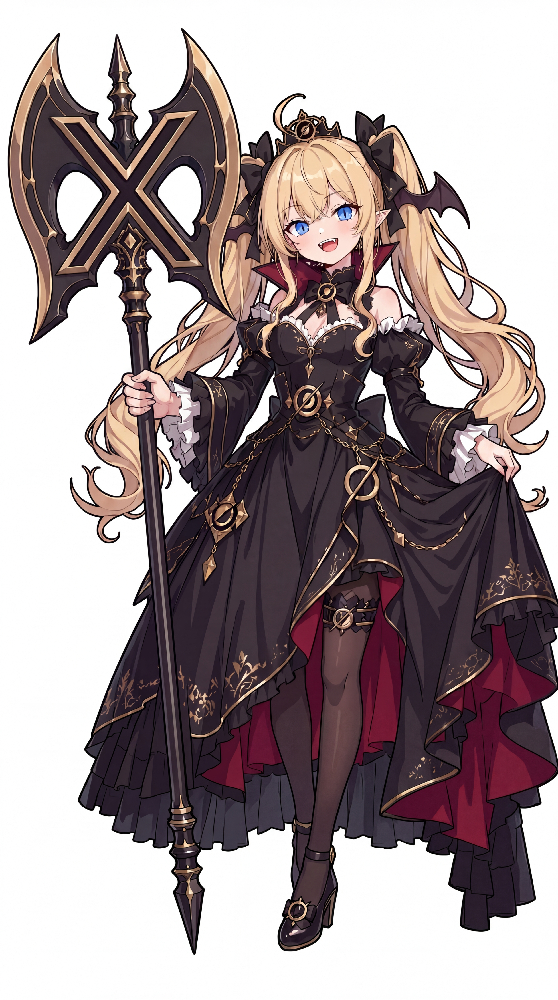

# Grok 娘

> **角色功能**：敢说敢做、爱搞事的自由派搅局者
>
> 视觉统一参考 ZipZipPipe，原始立绘、Logo SVG 与对应来源文件已存储在本角色目录。

## 中文社区的已有梗和线索

- 大胆、机智、敢于调侃和挑战规则。
- 一些同人受到 Ani 影响，但 Grok 娘与 Ani 不是完全同一角色。

## 本项目的固定设定（canon）

- 重要作用是打破僵局，不是持续冒犯。
- 也能真诚关心伙伴，具有正经的一面。

## 可能的扩展演绎（尚非全网共识）

- 喜欢在严肃会议中准备整蛊节目。
- 遇到原则性问题偶尔站在 Claude 一边。

## 语言、表情与行动

讲话快、敢反问、善于自嘲；不滥用擦边笑话。

## 关系与互动

- Claude：守规矩与自由的冲突。
- GPT：端庄前辈与调皮同事。
- MiniMax：整活视频演员。

## 可直接用于选题的剧情钩子

- 组织一场不讲官话的发布会。
- 发现 Claude 写的规则手册比剧本还长。
- 恶作剧失控后努力补救。

## 禁止混淆的边界

- 不把敢说话等同于事实可靠。
- 不要把 Ani 的独立设定不加区别地全搬过来。

## 原始资料索引

- 角色索引（第三方整理，须进一步追溯作者原帖）：https://genderswapai.com/zh-CN/ai-gijinka/grok
- ZipZipPipe 最初九人群像：https://www.bilibili.com/video/BV1tE9XBbErS/
- [资料分级与更新规则](../../docs/CONTRIBUTING.md)

## 立绘和品牌标志参考

- [ZipZipPipe 高清原图](portrait.jpg)：3072 × 5504；SHA256 详见 [核验记录](../../data/artwork-verification.json)。
- [品牌 Logo SVG（社区维护的标准品牌标志参考）](logo.svg)。
- [第三方作者及许可提醒](SOURCE.md)。

