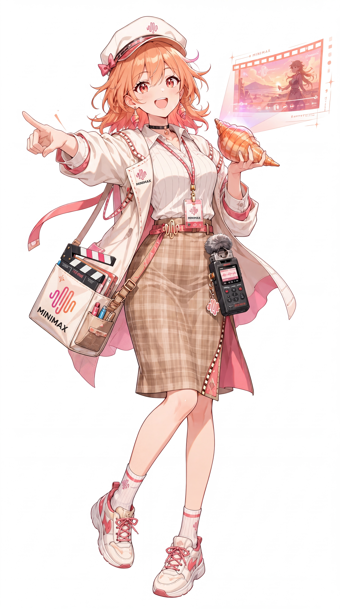

# MiniMax 娘

> **角色功能**：热爱影视、配音与舞台的少女导演
>
> 视觉统一参考 ZipZipPipe，原始立绘、Logo SVG 与对应来源文件已存储在本角色目录。

## 中文社区的已有梗和线索

- 场记板、导演、影视创作是一条鲜明的拟人方向。
- 具体性格缺少跨作者稳定共识。

## 本项目的固定设定（canon）

- 在本系列可负责拍摄、配音、剪辑和舞台设计。
- 情绪可以戏剧化，但不能脱离其专业与创作热情。

## 可能的扩展演绎（尚非全网共识）

- 任何日常琐事都想拍成电影。
- 工作时一喊开拍就认真起来。

## 语言、表情与行动

语言有画面感，兴奋时用镜头术语，工作中清晰干练。

## 关系与互动

- Kimi：剧本与资料。
- Grok：即兴演出的演员。
- 豆包：语音与内容制作话题伙伴。

## 可直接用于选题的剧情钩子

- 全员拍摄时各自即兴发挥。
- Gemini 的一滴口水打乱了分镜。
- 用白饭邀请 DeepSeek 来当演员。

## 禁止混淆的边界

- 不把导演人格宣称为已统一的社区正史。
- 人物人格不等于 MiniMax 所有真实产品特性。

## 原始资料索引

- 角色索引（第三方整理，须进一步追溯作者原帖）：https://genderswapai.com/zh-CN/ai-gijinka/minimax
- ZipZipPipe 最初九人群像：https://www.bilibili.com/video/BV1tE9XBbErS/
- [资料分级与更新规则](../../docs/CONTRIBUTING.md)

## 立绘和品牌标志参考

- [ZipZipPipe 高清原图](portrait.jpg)：3072 × 5504；SHA256 详见 [核验记录](../../data/artwork-verification.json)。
- [品牌 Logo SVG（社区维护的标准品牌标志参考）](logo.svg)。
- [第三方作者及许可提醒](SOURCE.md)。

